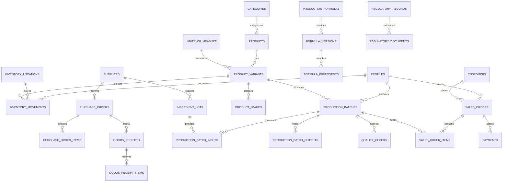

# Turashoboye Feeds — Database Schema Specification

## 1. Design Fundamentals
- **Primary Keys:** UUID v4 (`gen_random_uuid()`) for all primary identifiers, enabling client-side generation for offline record creation.
- **Monetary Storage:** Stored as integer whole Rwandan Francs (`BIGINT NOT NULL CHECK (amount >= 0)`), paired with a `currency_code VARCHAR(3) DEFAULT 'RWF'`.
- **Referential Integrity:** Foreign keys use `ON DELETE RESTRICT` on business domain entities to prevent accidental cascades.
- **Auditability:** All movements, financial transactions, and batch events are append-only. Hard `DELETE` is blocked by RLS policies.

---

## 2. Entity Relational Model

---

## 3. Core Tables Summary

| Table | Key Responsibility | Key Columns |
|---|---|---|
| `profiles` | User identity linked to Supabase Auth | `id`, `auth_user_id`, `role`, `display_name`, `mfa_enabled` |
| `units_of_measure` | Measurement definitions | `id`, `name`, `abbreviation`, `conversion_factor_to_base` |
| `inventory_locations` | Physical storage sites | `id`, `name`, `code`, `is_default`, `gln` |
| `categories` | Feed and ingredient groupings | `id`, `name`, `slug`, `display_order` |
| `products` | Core catalogue items | `id`, `category_id`, `name`, `slug`, `type`, `target_animal`, `published` |
| `product_variants` | Sellable package sizes & SKUs | `id`, `product_id`, `sku`, `package_size`, `price_rwf`, `cost_rwf`, `reorder_threshold`, `gtin` |
| `suppliers` | Procurement vendors | `id`, `name`, `phone`, `tin_number`, `gln` |
| `ingredient_lots` | Incoming raw material lots | `id`, `variant_id`, `supplier_id`, `lot_number`, `received_quantity`, `expiry_date`, `status` |
| `production_formulas` | Recipe headers | `id`, `name`, `current_version_number` |
| `formula_versions` | Immutable formulation versions | `id`, `formula_id`, `version_number`, `expected_output_qty`, `is_approved` |
| `production_batches` | Individual manufacturing runs | `id`, `batch_number`, `planned_output_qty`, `actual_output_qty`, `loss_qty`, `loss_percentage`, `status` |
| `quality_checks` | Quality inspection decisions | `id`, `batch_id`, `inspector_id`, `result`, `notes` |
| `inventory_movements` | Append-only stock ledger | `id`, `variant_id`, `location_id`, `type`, `quantity`, `reference_id`, `lot_id`, `batch_id`, `reason` |
| `customers` | Local clients | `id`, `name`, `phone`, `sector`, `address` |
| `sales_orders` | Customer order headers | `id`, `order_number`, `customer_id`, `status`, `subtotal_rwf`, `discount_rwf`, `total_amount_rwf` |
| `sales_order_items` | Sold items with batch trace | `id`, `order_id`, `variant_id`, `batch_id`, `quantity`, `unit_price_rwf`, `line_total_rwf` |
| `payments` | Financial settlements | `id`, `order_id`, `method`, `amount_rwf`, `reference`, `status`, `idempotency_key` |
| `regulatory_records` | Rwandan compliance entries | `id`, `category`, `authority`, `title`, `reference_number`, `status`, `verified_by` |
| `audit_logs` | Security & action history | `id`, `user_id`, `action`, `resource_type`, `resource_id`, `detail` |
| `sync_operations` | Offline ingestion queue | `id`, `client_id`, `operation_type`, `payload`, `status`, `error_message` |
| `settings` | Configurable platform thresholds | `key`, `value`, `description` |
