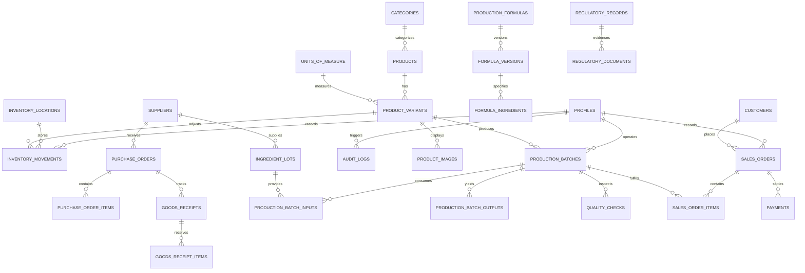

# Turashoboye Feeds — Database Schema Specification

## 1. Design Fundamentals
- **Primary Keys:** UUID v4 (`gen_random_uuid()`) for all primary identifiers, enabling client-side generation for offline operations.
- **Monetary Storage:** Stored as integer whole Rwandan Francs (`BIGINT NOT NULL CHECK (amount >= 0)`), paired with `currency_code VARCHAR(3) DEFAULT 'RWF'`. No floating-point rounding errors.
- **Referential Integrity:** Foreign keys use `ON DELETE RESTRICT` on business domain entities to prevent accidental cascade deletions.
- **Auditability & Immutability:** Stock movements, payments, and batch events are append-only. Hard `DELETE` is blocked by RLS policies and database triggers.
- **Row Level Security:** Enabled across all tables.

---

## 2. Entity Relational Model

---

## 3. Core Tables Reference

| Table | Purpose | Key Columns & Types |
|---|---|---|
| `profiles` | User identity linked to Supabase Auth | `id UUID PK`, `auth_user_id UUID UNIQUE`, `email TEXT`, `phone TEXT`, `role app_role`, `status VARCHAR(20)`, `is_active BOOLEAN`, `suspended_at TIMESTAMPTZ`, `suspended_by UUID`, `suspension_reason TEXT`, `mfa_enabled BOOLEAN` |
| `units_of_measure` | Measurement definitions | `id UUID PK`, `name TEXT`, `abbreviation TEXT`, `conversion_factor_to_base NUMERIC`, `is_active BOOLEAN` |
| `inventory_locations` | Physical storage sites & depots | `id UUID PK`, `name TEXT`, `code TEXT UNIQUE`, `address TEXT`, `type location_type`, `is_default BOOLEAN` |
| `categories` | Feed categories | `id UUID PK`, `name TEXT`, `slug TEXT UNIQUE`, `description TEXT`, `display_order INT` |
| `products` | Core animal feed products | `id UUID PK`, `category_id UUID`, `name TEXT`, `slug TEXT UNIQUE`, `type product_type`, `target_animal TEXT`, `published BOOLEAN` |
| `product_variants` | SKUs and pack sizes | `id UUID PK`, `product_id UUID`, `sku TEXT UNIQUE`, `package_size TEXT`, `unit_id UUID`, `price_rwf BIGINT`, `cost_rwf BIGINT`, `reorder_threshold NUMERIC`, `is_active BOOLEAN` |
| `product_images` | Product photo assets | `id UUID PK`, `product_id UUID`, `cloudinary_public_id TEXT`, `image_url TEXT`, `is_primary BOOLEAN` |
| `suppliers` | Grain and premix vendors | `id UUID PK`, `name TEXT`, `contact_name TEXT`, `phone TEXT`, `email TEXT`, `address TEXT`, `tin_number TEXT` |
| `purchase_orders` | Procurement POs | `id UUID PK`, `po_number TEXT UNIQUE`, `supplier_id UUID`, `status po_status`, `order_date DATE`, `total_amount_rwf BIGINT` |
| `ingredient_lots` | Received ingredient batches | `id UUID PK`, `variant_id UUID`, `supplier_id UUID`, `purchase_order_id UUID`, `lot_number TEXT UNIQUE`, `received_quantity NUMERIC`, `status lot_status`, `expiry_date DATE` |
| `production_formulas` | Feed formulation headers | `id UUID PK`, `name TEXT UNIQUE`, `description TEXT`, `current_version_number INT` |
| `formula_versions` | Versioned formulation recipes | `id UUID PK`, `formula_id UUID`, `version_number INT`, `output_variant_id UUID`, `expected_output_qty NUMERIC`, `is_approved BOOLEAN` |
| `formula_ingredients` | Ingredients per batch formula | `id UUID PK`, `formula_version_id UUID`, `ingredient_variant_id UUID`, `expected_quantity NUMERIC`, `unit_id UUID` |
| `production_batches` | Manufacturing milling runs | `id UUID PK`, `batch_number TEXT UNIQUE`, `product_variant_id UUID`, `planned_output_qty NUMERIC`, `actual_output_qty NUMERIC`, `loss_qty NUMERIC`, `loss_percentage NUMERIC`, `status batch_status` |
| `production_batch_inputs` | Lots consumed in a batch | `id UUID PK`, `batch_id UUID`, `lot_id UUID`, `quantity_used NUMERIC` |
| `production_batch_outputs` | Output yield from a batch | `id UUID PK`, `batch_id UUID`, `variant_id UUID`, `quantity_produced NUMERIC` |
| `quality_checks` | QA inspection records | `id UUID PK`, `batch_id UUID`, `inspector_id UUID`, `result quality_result`, `notes TEXT` |
| `customers` | Farmers & trade buyers | `id UUID PK`, `name TEXT`, `phone TEXT`, `address TEXT`, `auth_user_id UUID`, `tin_number TEXT` |
| `sales_orders` | Feed sales orders | `id UUID PK`, `order_number TEXT UNIQUE`, `customer_id UUID`, `location_id UUID`, `status order_status`, `total_amount_rwf BIGINT`, `recorded_by UUID` |
| `sales_order_items` | Line items per sales order | `id UUID PK`, `order_id UUID`, `variant_id UUID`, `batch_id UUID`, `quantity NUMERIC`, `unit_price_rwf BIGINT`, `line_total_rwf BIGINT` |
| `payments` | Financial settlements | `id UUID PK`, `order_id UUID`, `method payment_method`, `amount_rwf BIGINT`, `payment_date DATE`, `status payment_status`, `idempotency_key UUID UNIQUE` |
| `inventory_movements` | Immutable stock movement ledger | `id UUID PK`, `variant_id UUID`, `location_id UUID`, `type movement_type`, `quantity NUMERIC`, `unit_id UUID`, `lot_id UUID`, `batch_id UUID`, `reason TEXT` |
| `audit_logs` | Security & operational events | `id UUID PK`, `user_id UUID`, `action TEXT`, `resource_type TEXT`, `resource_id UUID`, `detail JSONB`, `created_at TIMESTAMPTZ` |

---

## 4. Calculated Views & Stored Procedures

### 4.1 Views
* **`view_stock_on_hand`**: Aggregates `inventory_movements` grouped by `variant_id` and `location_id`. Dynamically excludes inventory linked to lots or batches currently under quality hold (`status = 'held'`) from the `available_to_sell_qty` metric.

### 4.2 Core Transactional Procedures
1. **`complete_production_batch(p_batch_id, p_actual_output_qty, p_location_id, p_notes)`**:
   - Atomically records negative consumption movements for all batch inputs from their respective ingredient lots.
   - Records positive yield movement for finished feed output.
   - Computes milling loss percentage and records output in `production_batch_outputs`.
   - Transitions batch status to `'completed'` and writes to `audit_logs`.
2. **`record_sale_transaction(p_customer_id, p_location_id, p_order_items, p_payment, p_notes)`**:
   - Validates live stock availability to prevent overselling.
   - Inserts order header and order line items.
   - Deducts stock in `inventory_movements` (type `'sale'`).
   - Inserts payment record with idempotency key.
3. **`record_inventory_adjustment(p_variant_id, p_location_id, p_quantity, p_reason, p_lot_id, p_batch_id)`**:
   - Validates business reason.
   - Rejects adjustments causing negative stock balance.
   - Enforces approval threshold ($\ge 100\text{ kg}$ requires manager/owner).
   - Appends adjustment movement and logs audit event.
4. **`admin_set_user_role(target_profile_id, new_role)`**:
   - Validates caller is `super_admin` or `owner`.
   - Protects `super_admin` role (only superadmins can assign or modify).
   - Prevents demoting the last active Super Administrator.
   - Logs event to `audit_logs`.
5. **`admin_set_user_status(target_profile_id, new_status, reason)`**:
   - Disallows self-suspension.
   - Updates `status` and `is_active` (`FALSE` immediately locks out target from RLS).
   - Requires justification reason.
6. **`submit_customer_order(p_variant_id, p_quantity, p_payment_method, p_notes)`**:
   - Allows authenticated farmer to place self-service order.
   - Automatically resolves customer record linked to `auth.uid()`.
   - Inserts order, line items, and confirmed payment record.
